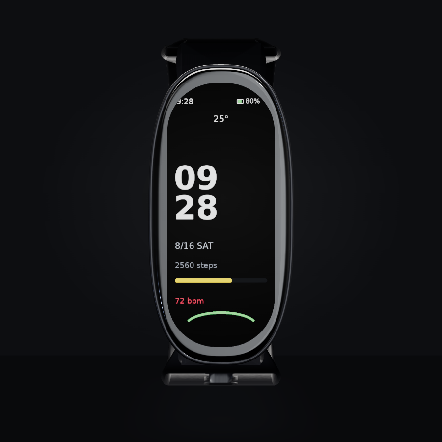

# 小米手环 10 · 高保真 Web 3D 配置器

浏览器里的 Xiaomi Smart Band 10 交互式 3D 查看器：官方配色切换、5 种表带材质、上传自定义表盘、
360° 旋转缩放、7 个相机预设与 PNG 截图。模型按毫米级真实比例程序化生成，导出 glTF 2.0 (GLB)，
材质参数逐项对照官方渲染图与拆解实拍标定。



## 快速开始

```bash
git clone <this-repo> miband10-configurator
cd miband10-configurator
npm install
npm run dev          # http://localhost:5173
```

生产构建：

```bash
npm run build && npm run preview
```

> 模型文件（`public/models/miband10.glb`）已随仓库提供，无需本地建模即可运行。
> 如需重新生成，见下面的「重建模型」。

## 功能

| 功能 | 说明 |
|---|---|
| 配色切换 | 午夜黑 / 冰川银 / 玫瑰粉 / 珍珠白（陶瓷版）/ 耀影金（特别版），同时改变中框、后盖、表带默认色 |
| 表带切换 | TPU 硅胶（12 孔，真穿孔）/ 科纳皮 / 蚕丝编织 / 不锈钢链 / 米兰尼斯 |
| 表带颜色 | 任意取色（金属类表带保留金属度） |
| 佩戴松紧 | 骨骼驱动开合，135–210 mm 腕围区间（闭合方向限位，避免自交） |
| 自定义表盘 | 上传 PNG/JPG，等比铺满 16.49 × 40.46 mm 显示区 |
| 相机预设 | 正面 / 背面 / 左侧 / 右侧 / 45° / 屏幕微距 / 表带连接处 |
| 截图 | 一键导出当前 canvas 为 PNG |
| 交互 | OrbitControls 旋转、缩放、阻尼 |

## 技术栈

Vite + React 19 + React Three Fiber 9 + drei 10 + Zustand 5 + three 0.180。

## 仓库结构

```
model/                  程序化建模管线（Node，无外部 3D 软件依赖）
  lib/mathx.mjs         超椭圆、轮廓偏移、样条、路径重采样
  lib/mesh.mjs          网格构建、法线/切线、朝向修正、SAT 三角相交
  lib/body.mjs          机身：玻璃、中框、后盖、传感器模组、触点、快拆按钮
  lib/band.mjs          表带：路径、截面、真穿孔、金属链、骨骼蒙皮
  lib/glb.mjs           glTF 2.0 写出器（accessor/skin/材质/贴图）
  textures.py           程序化贴图（表盘、编织、皮革、拉丝、米兰尼斯）
  hdri.py               程序化棚拍 HDRI（Radiance .hdr, RLE）
  build.mjs             组装并导出 public/models/miband10.glb
src/                    Web 前端
  scene/Watch.jsx       GLB 加载、材质覆写、骨骼开合、表盘贴图
  ui/Panel.jsx          控制面板
references/             参考素材、清单、尺寸表、像素测量脚本
tools/                  校验与自动化视觉测试
snapshots/              自动截图（round-1 / round-2）
docs/                   校验报告、材质标定、构建说明
CHANGELOG.md            迭代记录
```

## 重建模型

```bash
python3 -m pip install pillow numpy scipy      # 仅贴图/HDRI/测量脚本需要
npm run model        # 贴图 -> HDRI -> GLB
npm run check:gltf   # glTF 校验（0 error / 0 warning）
npm run check:intersect  # 表带骨骼开合自交检测
```

## 自动化视觉测试

需要 Chromium（Playwright 缓存）与 Xvfb：

```bash
npm run dev &                       # 先起 dev server
xvfb-run -a node tools/shoot.mjs --round 1
python3 tools/analyze.py snapshots/round-1
```

产物：`snapshots/round-1/<配色>/<表带>/<机位>.png`（5 × 5 × 7 = 175 张）与 `analysis.json`。

## 尺寸与参考

- 机身 46.57 × 22.54 × 10.95 mm（[mi.com 规格页](https://www.mi.com/global/product/xiaomi-smart-band-10/specs/)）
- 屏幕 1.72″ AMOLED，212 × 520，有效显示区 16.49 × 40.46 mm
- 平面轮廓超椭圆指数 2.79（由拆解实拍 T06 拟合）
- 全部参考图、来源 URL、像素测量见 `references/manifest.md`

## 自动检测结果

| 轮次 | 截图 | 自动判定 |
|---|---|---|
| round-1 | 175 张（5 配色 × 5 表带 × 7 机位） | 25 张报问题（背面机位裁切、陶瓷版偏暗） |
| round-2 | 175 张 | **0 张报问题** |
| acceptance | 8 个随机角度 | 无空白、无穿模、比例与参考图一致 |
| features | 8 项交互 | 8/8 PASS |

详见 `CHANGELOG.md`，原始数据在 `snapshots/*/analysis.json`。

## 部署

见 `docs/deploy.md`。仓库内含 GitHub Actions 工作流，推送到 `main` 后自动发布到 Pages。
`./deploy.sh` 会在已登录 `gh` 的环境下完成建库、推送与开启 Pages。

## 已知取舍

- 陶瓷版与耀影金仅有官方渲染图，无独立实拍，材质按渲染图与规格文字标定。
- 机身无实体侧键（与部分资料描述不同），模型按拆解实拍建模。
- 表带为单侧扣合形态，未建模蝶形扣/磁吸扣的完整机械结构（扣件区域为平滑过渡）。

## License

MIT（见 `LICENSE`）。`references/img/` 下的参考图片版权归各原始发布方所有，仅用于视觉比对与文档说明，不在 MIT 授权范围内，来源见 `references/manifest.md`。
